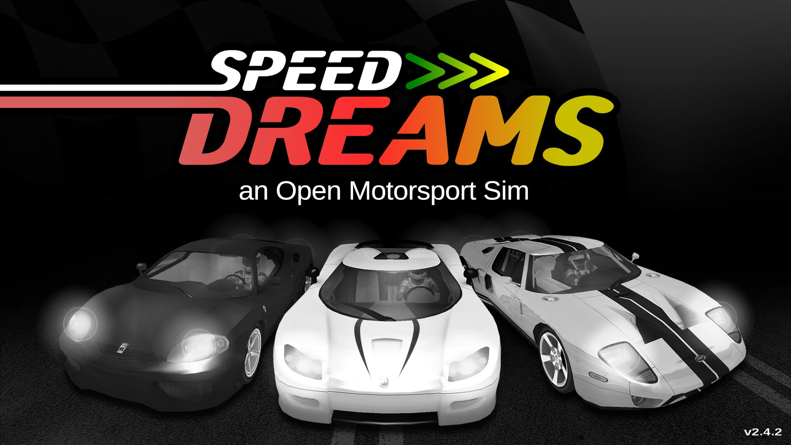
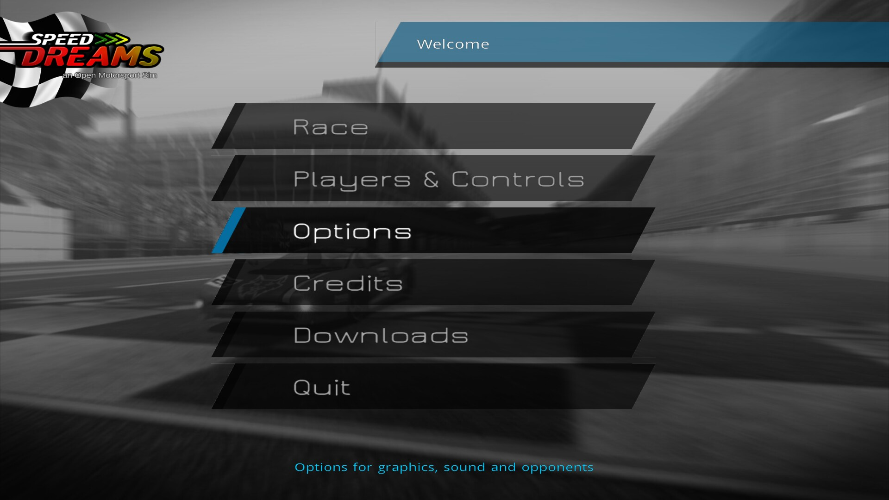
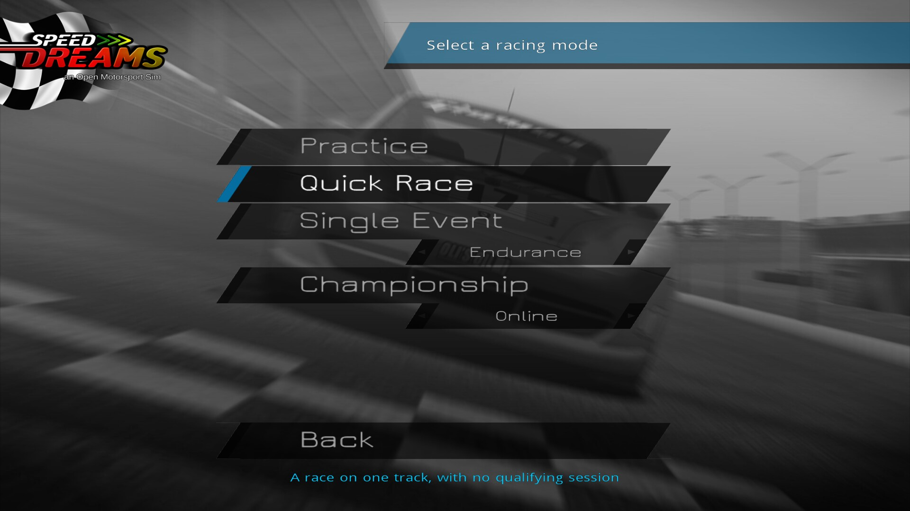
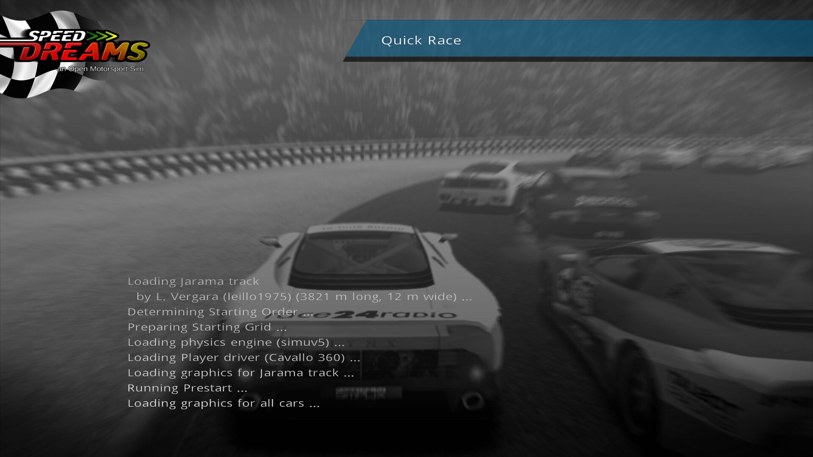
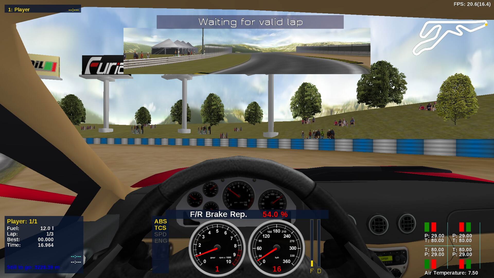
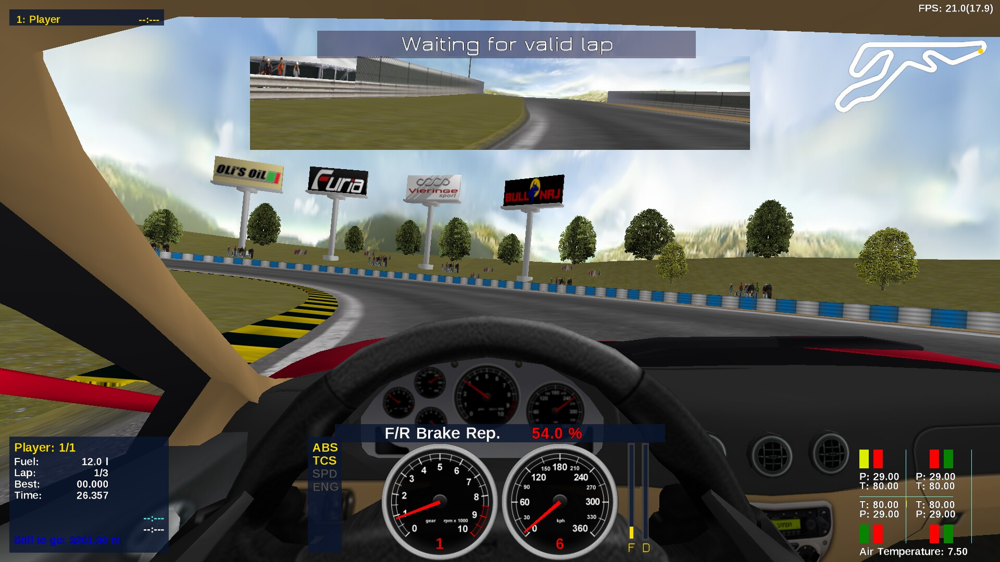

# Speed Dreams for LG webOS

[Speed Dreams](https://www.speed-dreams.net) 2.4.2, the open-source motorsport sim, built as a native webOS app (`com.pulp.speeddreams`). It ships with Speed Dreams' base cars and tracks, and the game's Downloads menu fetches more. It was developed and tested on an LG C1 running webOS 6.5.3 (Mali-G51 GPU).

## Screenshots

Taken on the LG C1 at 1080p.

| | |
|---|---|
|  |  |
| The title screen | The main menu |
|  |  |
| Choosing a racing mode | Loading a quick race |
|  |  |
| Driving at Jarama | Into a corner |

## Requirements

- **An ARMv8 CPU**, as in TVs with a 64-bit kernel such as the LG C1. The code is built for the Cortex-A55 in 32-bit mode, so it doesn't run on older ARMv7-only TVs.
- **OpenGL ES 2.**
- **Root is not needed.** It installs from the Homebrew Channel or with `ares-install` in Developer Mode.

## Playing

**Controls.**

- **Remote:**
  - in the menus: the arrows move, OK chooses and Back goes back;
  - in a race: Up accelerates, Down brakes, Left and Right steer;
  - in a race, Back stops it and opens the stop menu.
- **Game controller** (a DualShock 4 is what it was tested with):
  - the left stick steers;
  - R2 accelerates;
  - L2 brakes gently, and Cross brakes fully;
  - Triangle is the handbrake;
  - R1 and L1 shift up and down (the gearbox is automatic unless you change it);
  - Square changes the view: the driver's eye, the bonnet, the road ahead, then the chase cameras;
  - Options stops the race;
  - in the menus, the D-pad moves and Cross chooses.

  When a controller is connected, a race takes its input from it; otherwise from the remote. Bindings saved in the controls menu override both.

When you press Home, the game pauses until you come back: a running race stops and waits in its stop menu, and the music pauses.

**Settings and data.**

- **Settings, results and replays** go to the app folder's `home/`.
- **On a USB drive instead:** if a USB drive has a `speed-dreams` folder, they go to `speed-dreams/home/` on it, so they survive reinstalling the app.
- **A full data set:** cars and tracks from `speed-dreams-data` and its car and track repositories, placed in that folder's `data/`, replace the app's own.
- **Starting a race from the launch parameters:** `{"startrace": "<race>"}` starts that race (`config/raceman/<race>.xml`).

## How it works

- **Game:** Speed Dreams' code and data at tag `v2.4.2`, with `patches/speed-dreams-webos.patch` and `patches/speed-dreams-data-webos.patch`. It is built with the classic PLIB renderer (`ssggraph`) only: no OpenSceneGraph, track editor or XRandR. The patches cover:
  - **Startup (`main.cpp`):** the binary named in `main` does a wrapper's work itself, since the luna bus only knows an app by that executable. It:
    - writes the log to `/tmp/speed-dreams.log`;
    - lets the remote's Back button reach the game as Escape;
    - finds the libraries, modules, robots and data in the app folder;
    - picks the home folder, on a USB drive or in the app folder;
    - reads the app manager's JSON launch parameters.
  - **Graphics:** the game draws with OpenGL 2.1, which webOS lacks. [gl4es](https://github.com/ptitSeb/gl4es) (linked as `libGL`) translates it to OpenGL ES 2 on a context SDL makes.
  - **Resolution:** the Mali-G51 can't fill 1080p with a race at a playable rate. So the 3D view is drawn at 720 lines into a texture that fills the screen; `graph.xml`'s "render height" sets it, and 0 means the full screen. The mirror, the boards and the menus are drawn at full resolution.
  - **Controls:**
    - the remote's Back is Escape;
    - the game controller drives the menus like the remote;
    - a race reads the controller or the remote, whichever is there;
    - Square steps through the views worth driving with;
    - from the driver's eye, the plain steering wheel is shown, without the driver's arms.
  - **Home:** the game pauses as described above, and leaves the game controller alone (it would otherwise drive the hidden menus while it drives the TV's).
  - **Downloads menu:** adapted to webOS 6's libcurl 7.61, which lacks `curl_multi_poll`.
- **Libraries:**
  - webosbrew's [SDL 2.30.12 webOS port](https://github.com/webosbrew/SDL-webOS) (release `2.30.12-webos.1`);
  - gl4es and SGI's GLU as ptitSeb keeps it;
  - PLIB 1.8.5;
  - OpenAL Soft (SDL 2 backend only), libvorbis and SDL2_mixer;
  - ENet, cJSON, minizip and RHash;
  - libjpeg 8 and the toolchain's libstdc++, since the TV's libstdc++ is GCC 8's.

  They are shipped in `lib/` and found through the `$ORIGIN/lib` rpath. libpng, zlib, expat, curl, Ogg and FreeType come from the TV.

## Build

On an x86-64 Linux machine with git, curl, make and Python 3:

```sh
./build-deps.sh  # first run: fetches the openlgtv toolchain (2026.08-webos); builds the libraries into prefix/
./build-sd.sh    # first run: clones Speed Dreams 2.4.2 and applies the patch; builds into build/sd
./package.sh     # first run: clones the data and applies its patch; writes output/com.pulp.speeddreams_<version>_all.ipk and the manifest
```

`package.sh` checks that every symbol the game needs is defined by a library on the TV, given a copy of the TV's libraries: run `tools/fetch-tv-libs.sh root@<tv address>` once. Without that copy, the check is skipped. `probe/probe.c` is the test that showed gl4es could carry the game: it draws scenes of growing weight through gl4es and logs their frame rates.

To install a build by hand as root on the TV:

```sh
luna-send -i -f luna://com.webos.appInstallService/dev/install \
  '{"id":"com.pulp.speeddreams","ipkUrl":"/tmp/com.pulp.speeddreams_0.3.0_all.ipk","subscribe":true}'
```

## License

Speed Dreams, the patches and the scripts are GPL-2.0-or-later; see `LICENSE`. Speed Dreams' data comes under the licenses its repository lists.

Licenses of the bundled libraries:

- SDL and SDL2_mixer: zlib license;
- gl4es: MIT license;
- GLU: SGI Free Software License B;
- PLIB and OpenAL Soft: LGPL;
- libvorbis: BSD license;
- ENet, cJSON and minizip: MIT or zlib licenses;
- RHash: 0BSD;
- libjpeg: the IJG license;
- libstdc++: GPL-3.0 with the GCC Runtime Library Exception.
